

 

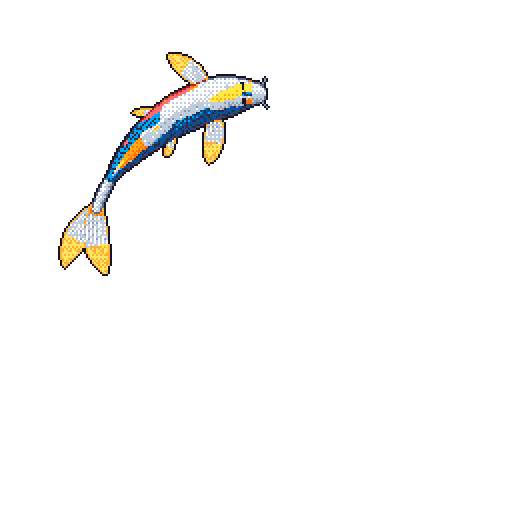

my koi, redrawn every night from my GitHub activity

<i>sometimes great responsibilty comes without great powers</i>

Hi!! I'm Rahul and this section is written by me personally😂, am a final-year CS & Engineering student at IIIT Manipur, specializing in AI & Data Science. I am a kind of person who just likes to build, it is one of my hobby though, I like how these things we tweaks turns out to be working in different different ways. That's why I chose applied AI as my career choice, I like to build products in a way nobody have imagined - I am not a research guy obviously😁. Right now I split my time between competitive challenges, placement prep, and shipping side projects. Hope you'll like my profile.




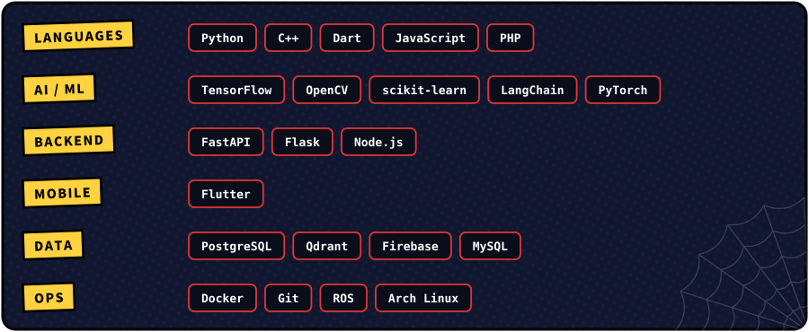


<table>
<tr>
<td width="50%"></td>
<td width="50%"><a href="https://pypi.org/project/vidchain"></a></td>
</tr>
<tr>
<td width="50%"><a href="https://github.com/rahulsiiitm/AgriHive-Frontend"></a></td>
<td width="50%"><a href="https://github.com/rahulsiiitm/vyoma"></a></td>
</tr>
</table>


 


